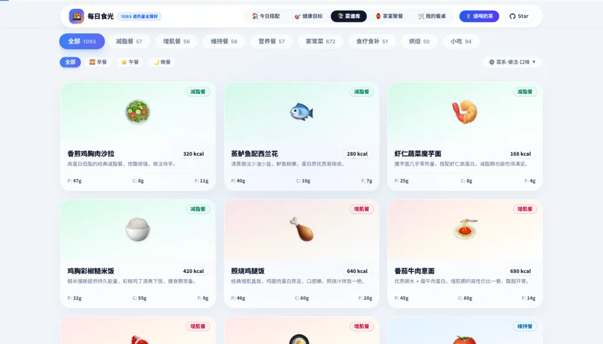

# 🍜 每日食光 · EveryDay Food

冰川雾蓝底色的液态果冻玻璃风格中文食谱站：1500 道家常菜和健康食谱，热量、营养、做法都替你算好、整理好了。纯前端 SPA，线上在 [meirishiguang.com](https://meirishiguang.com)。


## 支持一下

如果这个项目对你的日常下厨或健康饮食有所帮助，欢迎点个 Star ⭐，谢谢！

[](https://github.com/Jiayu-zheng1/EveryDay_Food)
[](https://github.com/Jiayu-zheng1/EveryDay_Food)
## 功能

- **1500 道食谱**：减脂 / 增肌 / 维持 / 营养四大类各 56–57 道，另有 902 道家常菜、58 道食疗、96 道烘焙、218 道小吃，每道都带食材、做法和营养数据。
- **首页 Bento 驾驶舱**：今日灵感主推大卡（配三大营养素微指标）、专属热量缺口速览、四大厨房入口矩阵与热门好菜卡片，一屏看清今天该干什么。
- **今日三餐搭配**：人数（1–6 人）与每餐菜数（早 1–3、午 1–4、晚 1–4）可调，按人份换算份量与热量；同一餐里哪道不顺眼就单换哪道，整份搭配能一键打包进餐桌。
- **饭类约束**：炒饭 / 盖饭 / 焖饭 / 烩饭 / 饭团等米饭主食全天至多出现 1 道，生成、单换、智能搭配三条链路都拦住了。
- **健康目标**：填年龄、性别、身高、体重、活动量和目标，算 BMI、基础代谢、每日目标热量与三大营养素克数；输入不合法会提示而不是给 NaN，结果存在本地，刷新不丢，并能一键生成智能三餐搭配、按四大分类浏览目标菜谱。
- **菜谱库**：分类、餐次（早 / 午 / 晚）、菜系（川 / 湘 / 粤 / 鄂 / 鲁 / 苏浙 / 北方 / 徽 / 闽 / 东北 / 滇 / 陕 / 新疆 / 家常）、做法（20 种）、口味（16 种）组合筛选，高级条件收在抽屉里；关键词直接搜菜名、简介和食材（「冰箱搜菜」），也能按热量升降序或蛋白质排序，滚到底自动加载下一批。
- **家宴聚餐**：四菜一汤 / 六菜一汤 / 十全十美三种规格，凉菜、硬菜、热菜、汤、主食、甜品分池抽取，整桌重抽或单道换菜，菜系筛选会优先命中，配好直接进家庭餐桌。
- **我的餐桌**：实时汇总热量和营养，一键生成购物清单——「黄瓜 100 克 + 半根」自动合并成 200 克，调料单独归一类；清单按货架分组（肉禽蛋品 / 水产海鲜 / 蔬菜菌菇 …），支持复制纯文本、复制 Markdown、导出 `.md`，逐项打卡进度存在本地。
- **做法弹窗**：点卡片看食材、分步做法、每份和每 100g 的营养；「专注下厨」模式全屏大字、Screen Wake Lock 防息屏，还能从步骤文字里自动识别时长开计时器。
- **PWA**：能装到桌面 / 手机，离线也能打开，断网有提示。
- **视觉**：VisionOS 风的液态果冻玻璃浅色主题——冰川灰蓝底、超透光毛玻璃卡片、水滴胶囊按钮，配鼠标跟随光源、滚动进度条和入场动画。

## 截图

| 首页 · Bento 驾驶舱 | 菜谱库 · 筛选 |
| :---: | :---: |
|  |  |

| 家宴聚餐 · 多规格 | 我的餐桌 · 购物清单 |
| :---: | :---: |
|  |  |

## 技术栈

React 18 + TypeScript（strict）+ Vite 6 + Tailwind CSS v4 + Vitest。食谱数据在构建时从 `src/data/*.ts` 导出成 JSON（约 946KB），运行时 fetch 加载、内存缓存，不打包进 JS bundle。视觉层是 Tailwind v4 `@theme` 主题变量加自定义工具类：`.liquid-card` 毛玻璃卡片、`.jelly-pill` 水滴胶囊。

## 本地跑起来

```bash
git clone https://github.com/Jiayu-zheng1/EveryDay_Food.git
cd EveryDay_Food
npm install

npm run dev      # 开发服务器，默认 http://localhost:5173
npm test         # 64 个单元测试
npm run build    # 生产构建，输出到 dist/
npm run preview  # 本地预览生产包
```

## 测试

`npm test` 跑 64 个 Vitest 用例（3 个文件，node 环境纯函数测试，不碰 DOM 和网络）：

- 营养计算：BMI / BMR / TDEE / 目标热量与宏量克数，含除零和边界
- 三餐搭配：超时防挂起、结果合理性回归，饭类全天至多 1 道（生成 / 单换 / 智能搭配）
- 购物清单：同单位合并（黄瓜 100 克 + 半根 → 200 克）、多食材行解析、单位换算、Markdown 导出
- 家庭餐桌：本地持久化与营养汇总
- 表单校验：年龄 / 身高 / 体重边界
- 数据自洽：全量断言每道菜宏量与热量吻合

## 部署

线上跑在 Cloudflare Pages，push 到 main 后 GitHub Actions 自动构建部署（项目名 `everyday-food`）。SPA fallback 和缓存策略写在 `public/_redirects`、`public/_headers` 里。

**方式一 · GitHub Actions（推荐，push 即部署）**

`.github/workflows/deploy.yml` 已配好，首次需要：

1. 在 Cloudflare 建 Pages 项目 `everyday-food`（项目名不同就改 workflow 里的 `--project-name`）
2. 仓库 Settings → Secrets and variables → Actions 加两个 secret：
   - `CLOUDFLARE_API_TOKEN`：Cloudflare API Token（权限 Pages → Edit）
   - `CLOUDFLARE_ACCOUNT_ID`：Cloudflare 账号 ID（仪表盘首页右下角）
3. 之后每次 push 到 main 自动部署，也可以在 Actions 页面手动触发

**方式二 · Dashboard 连 Git**

新建 Pages 项目 → 连接仓库 `EveryDay_Food` → 构建命令 `npm run build`，输出目录 `dist`。

**方式三 · Wrangler CLI**

```bash
npm run build
npx wrangler pages deploy dist --project-name everyday-food
```

## 数据

数据源是 `src/data/*.ts`，构建时由 `scripts/export-data.mjs` 导出成 `public/data/meals.json`（1500 道，约 1.35MB），运行时由 `src/api/meals.ts` fetch 加载并缓存。

部分小吃与烘焙做法参考 [HowToCook](https://github.com/Anduin2017/HowToCook)（Unlicense，公共领域）后，按本项目字段、份量与营养口径重写；另有 225 道菜谱通过 `npm run import:howtocook` 从 HowToCook 解析导入。新增 50 道公共领域古籍菜与 50 道原创菜，古籍只取菜名与源流，做法为本项目新写。所有导入/新写菜谱均标记 `nutritionQuality: 'estimated'`，页面会显示估算提示。

### 分类数量

| 分类 | 数量 |
| --- | --- |
| 减脂餐 | 57 |
| 增肌餐 | 56 |
| 维持餐 | 56 |
| 营养餐 | 57 |
| 家常菜 | 902 |
| 食疗食补 | 58 |
| 烘焙 | 96 |
| 小吃 | 218 |
| **合计** | **1500** |

家常菜里 138 道（118 家常 + 18 小吃 + 1 食疗 + 1 营养）整理自《老乡鸡菜品溯源报告》，按家庭份量重写。

### 菜系分布

| 菜系 | 数量 | | 菜系 | 数量 |
| --- | --- | --- | --- | --- |
| 家常 | 498 | | 湘菜 | 55 |
| 北方 | 80 | | 鲁菜 | 11 |
| 粤菜 | 86 | | 鄂菜 | 9 |
| 川菜 | 53 | | 闽菜 | 42 |
| 徽菜 | 50 | | 滇菜 | 45 |
| 东北菜 | 40 | | 陕菜 | 40 |
| 苏浙 | 42 | | 新疆 | 42 |

### 字段

每道菜 13 个核心字段：`id`（唯一）、`name`、`category`（分类）、`cuisine`（菜系）、`emoji`（图标）、`kcal`（每份热量）、`desc`（简介）、`ingredients`（食材）、`steps`（3–6 步做法）、`nutrition`（每份蛋白 / 碳水 / 脂肪）、`per100g`（每 100g 营养）、`servingSize`（份量）、`mealType`（早 / 午 / 晚餐次，数组，一道菜可跨多餐）。

另有可选标签：`methods`（做法，1078 道有值）、`flavors`（口味，全库覆盖），菜谱库的做法 / 口味筛选按它们匹配。

分类 key：`fat-loss` / `muscle-gain` / `maintain` / `nutrition` / `home` / `therapy` / `bakery` / `snack`
菜系 key：`chuan` / `xiang` / `yue` / `e` / `lu` / `suzhe` / `bei` / `hui` / `min` / `dongbei` / `dian` / `shan` / `xinjiang` / `generic`

营养数据有两道自检（测试里断言）：每份营养素 ≈ 每 100g × 份量 / 100；每份热量 ≈ 蛋白 × 4 + 碳水 × 4 + 脂肪 × 9。

## 目录结构

```
├── .github/workflows/deploy.yml  # CI/CD：push 自动构建部署
├── public/                       # 静态资源：manifest / sw / _redirects / _headers / data/meals.json
├── scripts/export-data.mjs       # 数据导出脚本
├── src/
│   ├── api/                      # 数据访问层（fetch / 缓存 / 分类元信息）
│   ├── components/               # UI 组件（驾驶舱 / 菜谱库 / 健康目标 / 家宴 / 餐桌 / 弹窗）
│   ├── data/                     # 1500 道食谱数据（分类 / 菜系 / 家常菜分批 TS 文件）
│   ├── hooks/                    # 自定义 hooks（数据加载 / 三餐搭配 / 营养计算 / 餐桌持久化）
│   ├── lib/                      # 纯函数：营养算法 / 购物清单解析 / 做法口味枚举
│   ├── App.tsx                   # 入口 + hash 路由（#home / #goals / #library / #newyear / #table）
│   └── index.css                 # Tailwind v4 主题与液态玻璃工具类
└── docs/screenshots/             # README 截图
```

## 许可

- **项目代码与自有菜谱数据**：MIT License。
- **`src/data/howtocook-import.json`**：改编自 HowToCook，原文为 Unlicense（公共领域，无署名与 share-alike 义务）。
- **`src/data/classics-extra.ts` 中的古籍菜名与源流**：来自《随园食单》《调鼎集》等公共领域作品；现代做法为本项目新写。

本项目只使用公共领域/Unlicense 来源的菜谱；不包含 CC BY-SA 等带署名或共享义务的数据。

## 🧋 支持与赞助作者

独立开发与长期数据整理不易。为了让大家能吃得健康、做饭省心，本项目收录并整理了 **1500 道食谱**，逐一核算热量与三大营养素，手写购物清单智能合并与防息屏烹饪模式，并持续保持纯净无广告的开源体验。

如果你觉得「每日食光」对你的日常生活有所帮助，或者为你解决了一点点“今天吃什么”的日常烦恼，欢迎请作者喝杯奶茶 🧋 或加个鸡腿 🍗，非常感谢你的认可与温暖支持！每一份心意都是项目持续维护和优化迭代的最大动力 ❤️

站点内页脚与首次进入的公告弹窗均可打开赞助弹窗，支持微信与支付宝两种扫码方式。

<div align="center">
  
  
  <p><sub>微信 / 支付宝扫一扫 · 感谢你的支持与鼓励 ❤️</sub></p>
</div>
